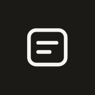
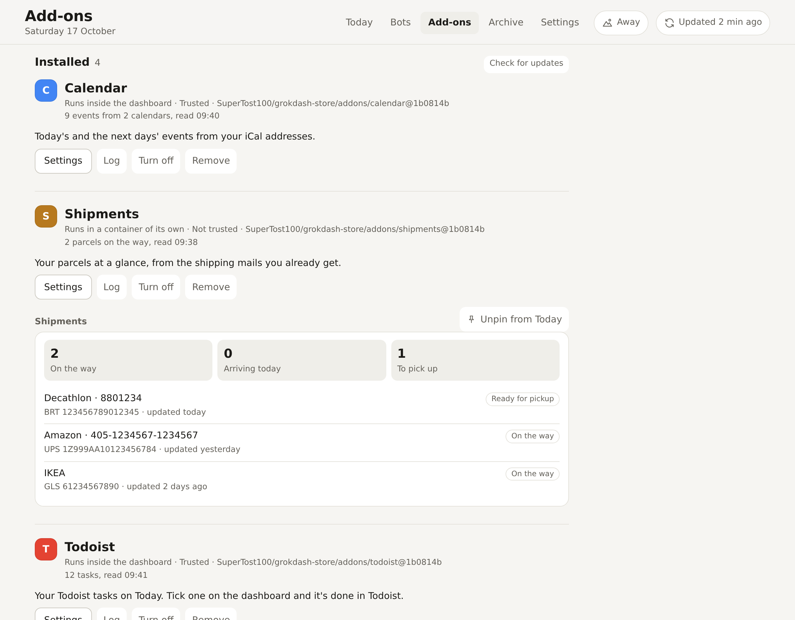

<p align="center">
  
</p>

<h1 align="center">Grok Bot Dashboard store</h1>

<p align="center">
  Add-ons and apps for the <a href="https://github.com/SuperTost100/Grok-Bot-Dashboard">Grok Bot Dashboard</a>: Todoist, Calendar, Mail, WhatsApp, PoliTO, Shipments and Plan my day.<br>
  You install them from the dashboard's Add-ons page with one click, and each one feeds its cards, events, to-dos or panel into the same page.
</p>

<p align="center">
  <a href="https://github.com/SuperTost100/grokdash-store/actions/workflows/ci.yml"></a>
  <a href="LICENSE"></a>
</p>

<p align="center">
  <a href="#install">Install</a> ·
  <a href="docs/writing-addons.md">Write your own</a>
</p>

<picture>
  <source media="(prefers-color-scheme: dark)" srcset="docs/screenshots/addons-dark.png">
  
</picture>

## Why a store

The dashboard collects what your Grok Bots want from you. Everything else it shows, your mail, chats, calendar, to-dos and parcels, comes from add-ons and apps in a store like this one. That keeps the dashboard itself small, and lets anyone add a source for their own life without forking it.

A store is any GitHub repo with a `store.json`. This one is the default. The dashboard installs straight from the repo at a pinned commit, so there's nothing to download or build, and updates only arrive when you press Update.

## What's in it

| Name | Kind | What it does | Asks for |
| --- | --- | --- | --- |
| Todoist | Add-on | Your tasks on Today; tick one and it's done in Todoist. | Nothing |
| Calendar | Add-on | Today's and the next days' events from your iCal addresses. | Nothing |
| Mail | Add-on | Up to three IMAP mailboxes; triage decides what needs you. | Triage |
| WhatsApp | App, about 700 MB | Two WhatsApp numbers through WAHA, read-only; link a number by scanning the QR code in its panel. | Triage |
| PoliTO | App, about 250 MB | Course notices and deadlines from the Politecnico di Torino, through [areadidattica](https://github.com/SuperTost100/areadidattica-cli). | Nothing |
| Shipments | Add-on | Your parcels at a glance, from the shipping mails you already get, with a card when one arrives today or waits for pickup. | Your mail |
| Plan my day | Add-on | Fits your to-dos into your free time; a draft for tomorrow every evening, and nothing goes in your calendar until you approve it. | Agenda, to-dos, handoffs, Jev |

An **add-on** is one script. An **app** runs its own containers, so it needs the dashboard's Docker setup. "Asks for" is what it gets once you trust it; untrusted, it reaches only its own cards and panel. [How trust works](https://github.com/SuperTost100/Grok-Bot-Dashboard/blob/main/docs/addons.md#trust).

## Install

1. Open your dashboard and go to **Add-ons**. This store is connected by default.
2. Pick one, read what it asks for, fill in its settings, choose whether to trust it, and press **Install**.

To install from another repo, paste a link to its folder (`https://github.com/<owner>/<repo>/tree/main/<folder>`) or connect it as a store with `owner/repo`.

## Your data

Each add-on talks to the dashboard over its API with a token of its own. Beyond that:

- **Todoist** calls Todoist's API with your token.
- **Calendar** fetches the iCal addresses you give it.
- **Mail** logs in to your IMAP servers.
- **WhatsApp** runs WAHA, which links to your account like WhatsApp Web, and only reads.
- **PoliTO** runs areadidattica, which logs in to the PoliTO Students app API as you.
- **Shipments** reads only the mail the dashboard already has, and calls no one.
- **Plan my day** asks Jev (on the dashboard's OpenRouter key) how long a to-do takes when Todoist doesn't say, and hands the approved plan to your Secretary bot to write in Google Calendar.

None of them send anything else anywhere.

## Development

Node.js 24 or newer.

```bash
git clone https://github.com/SuperTost100/grokdash-store.git
cd grokdash-store
npm ci
npm test          # unit tests for every add-on, no network
npm run build     # bundles src/<name> and the SDK into each add-on's single file
npm run check     # every manifest, store.json, and that the built files match the sources
```

Commit the built files: the dashboard installs the repo as it is. [Writing an add-on or an app](docs/writing-addons.md) covers the manifest, the SDK and the rules apps follow.

## License

[MIT](LICENSE)
